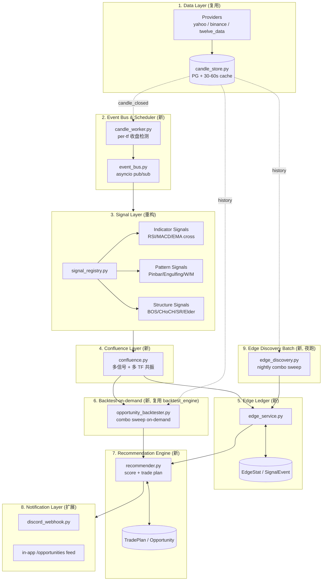
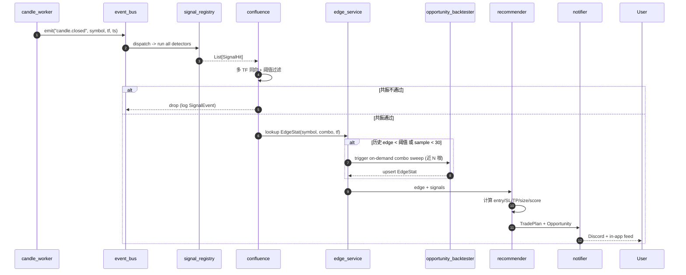
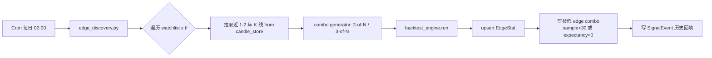
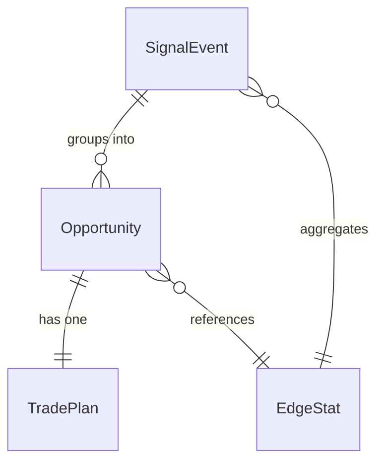

# Market Replay - 自我感知告警系统架构 (Self-Aware Alert System)

> 版本: v2.0 架构重设计草案
> 状态: Proposal / 待实施
> 目标: 将现有 "手动告警 + 手动回测" 工具改造为 **事件驱动 + 历史 edge 自学习** 的自动化交易机会发现管道。

---

## 0. 设计目标与核心理念 (Vision)

### 0.1 痛点 (Why Redesign)

当前系统的核心局限:

| 维度 | 现状 | 缺陷 |
|---|---|---|
| 触发方式 | APScheduler 5 分钟轮询 | 非事件驱动、延迟高、错过 K 线收盘瞬间 |
| 告警语义 | 用户手写规则 (RSI<30 等) | 没有 "这条规则历史上能赚钱吗" 的反馈 |
| 回测 | 用户手动跑 backtest 页面 | 与告警割裂,告警里看不到 edge |
| 信号组合 | 固定 8 strategy + AND/OR | 无组合搜索 (combo sweep),无自动剪枝 |
| 多周期 | 单 timeframe | 无 confluence (多周期共振) 检查 |
| 出场 | 固定 SL/TP 或反向信号 | 无出场指标组合,无 R-multiple 跟踪 |
| 持续学习 | 无 | 没有 per-symbol/per-combo 的 win-rate 账本 |

### 0.2 重设计目标 (What "Self-Aware" Means)

系统应能 **自己回答**:
1. "现在 BTCUSDT 4h 上是不是出现了交易机会?" — Signal scanner
2. "这次出现的信号组合,在过去 1 年里胜率/期望值多少?" — Edge ledger
3. "如果做这单,入场、止损、止盈、仓位 R 应该是多少?" — Recommendation engine
4. "我应该信任这个机会到什么程度?" — Confidence score

最终给用户的是 **一条整合告警**:
> [BTCUSDT 4h] 多头机会 - 置信度 78
> 信号: Pinbar @ 200EMA + RSI 背离 + H1 同向 (3 信号共振)
> 历史 edge: 该组合近 18 个月触发 41 次, 胜率 63%, 平均 R = 1.45, 期望值 +0.61R (样本足够)
> 交易计划: 入场 65,420 / SL 64,180 (-1.9%) / TP 67,950 (+3.9%) / 建议仓位 1.0R
> 来源: Confluence + EdgeLedger + OpportunityBacktester

---

## 1. 分层架构 (Layered Architecture)

### 1.1 总览图 (Component Diagram)



### 1.2 实时机会管道 (Live Opportunity Pipeline)



### 1.3 离线 Edge 发现管道 (Nightly Batch)



---

## 2. 模块清单 (Module Inventory)

### 2.1 新增文件 (New Files)

| 路径 | 职责 (一句话) |
|---|---|
| `backend/app/core/event_bus.py` | 进程内 asyncio pub/sub,事件: `candle.closed`, `signal.fired`, `opportunity.detected`, `tradeplan.ready` |
| `backend/app/core/signal_registry.py` | Signal generator 注册器,统一 `Signal` 协议 (`detect(candles) -> List[SignalHit]`) |
| `backend/app/core/signals/indicator_signals.py` | 包装 `indicators.py`: RSI 超买/超卖/背离、MACD 金叉、EMA 交叉等 |
| `backend/app/core/signals/pattern_signals.py` | 包装 `price_action.py`: Pinbar/Engulfing/W/M |
| `backend/app/core/signals/structure_signals.py` | 包装 `sr_levels.py` + `elder_impulse.py` + `market_structure.py`: SR 触碰、Elder 转色、BOS/CHoCH |
| `backend/app/core/confluence.py` | 多信号 + 多 TF 共振检查;输出 `ConfluenceResult` |
| `backend/app/core/opportunity_backtester.py` | 按需回测编排器,调用 `backtest_engine` 跑 combo,返回 `EdgeSnapshot` |
| `backend/app/core/edge_service.py` | EdgeStat CRUD + Wilson 置信区间 + 滚动衰减 |
| `backend/app/core/recommender.py` | 计算 entry/SL/TP/size/confidence_score |
| `backend/app/core/trade_plan.py` | TradePlan 数据模型 + ATR-based SL/TP 默认策略 |
| `backend/app/tasks/candle_worker.py` | 监听新 K 线收盘,产生 `candle.closed` 事件 (取代旧 5 分钟轮询) |
| `backend/app/tasks/edge_discovery.py` | 夜跑 batch:全 watchlist combo sweep -> EdgeStat |
| `backend/app/tasks/opportunity_consumer.py` | 订阅 event_bus,串联 confluence -> edge -> recommender -> notifier |
| `backend/app/api/opportunities_api.py` | `/api/opportunities`, `/api/opportunities/{id}` |
| `backend/app/api/edge_api.py` | `/api/edge/{symbol}` 查询历史 edge ledger |
| `backend/app/api/recommender_api.py` | `/api/recommender/explain`, `/api/recommender/thresholds` |
| `backend/app/schemas/opportunities.py` | Pydantic schemas |
| `backend/app/schemas/edge.py` | Pydantic schemas |
| `frontend/app/(main)/opportunities/page.tsx` | 机会 feed 页 |
| `frontend/components/opportunities/OpportunityCard.tsx` | 单条机会卡 (置信度 + win-rate chip + combo + trade plan) |
| `frontend/components/opportunities/EdgeBadge.tsx` | 胜率 / 期望值 / 样本数小标 |
| `frontend/components/chart/TradePlanOverlay.tsx` | 在 `CandlestickChart.tsx` 上叠加 entry / SL / TP 三条线 |
| `frontend/lib/api/opportunities.ts` | React Query hooks |

### 2.2 重构 / 扩展文件 (Changed Files)

| 路径 | 变更 | 复用 |
|---|---|---|
| `backend/app/core/backtest_engine.py` | 抽出 `run_combo(candles, entry_combo, exit_combo, combine_mode)` 纯函数,供 `opportunity_backtester` 与 `edge_discovery` 共用 | **完全复用** 8 strategy + AND/OR/MAJORITY |
| `backend/app/core/alert_engine.py` | 标记 deprecated;Phase 4 删除 | — |
| `backend/app/core/candle_store.py` | 新增 `on_new_candle_callback` 钩子供 `candle_worker` 订阅 | **复用** 全部 PG + cache 逻辑 |
| `backend/app/core/discord_webhook.py` | 新增 `send_opportunity(plan: TradePlan)` 富文本 embed | 复用 |
| `backend/app/core/indicators.py` | 不变,仅被 `indicator_signals.py` 包装 | **完全复用** |
| `backend/app/core/price_action.py` | 不变,被 `pattern_signals.py` 包装 | **完全复用** |
| `backend/app/core/sr_levels.py` / `elder_impulse.py` / `market_structure.py` | 不变,被 `structure_signals.py` 包装 | **完全复用** |
| `backend/app/tasks/alert_scheduler.py` | Phase 1 共存,Phase 3 切换为只跑 `edge_discovery` cron;Phase 4 删除 | — |
| `backend/app/models/models.py` | 新增 4 张表 (见 §3) | — |
| `backend/app/api/router.py` | 注册新路由 | — |
| `frontend/app/(main)/alerts/page.tsx` | 改为编辑 `recommender_thresholds` (min_winrate / min_sample / min_score) | — |
| `frontend/app/(main)/page.tsx` (dashboard) | 增加 "Top opportunities now" 区块 | — |
| `frontend/components/chart/CandlestickChart.tsx` | 接受 `tradePlan?: TradePlan` prop,渲染 overlay | **复用** |

---

## 3. 数据模型 (Data Model)

### 3.1 ER 关系



### 3.2 SQLAlchemy 表定义 (草案)

```python
# backend/app/models/models.py 新增

class SignalEvent(Base):
    """每一次信号触发都落库,用于 N 根 K 线后的 outcome 跟踪 (forward test)。"""
    __tablename__ = "signal_events"
    id: Mapped[int] = mapped_column(primary_key=True)
    symbol: Mapped[str] = mapped_column(String(32), index=True)
    timeframe: Mapped[str] = mapped_column(String(8), index=True)
    signal_name: Mapped[str] = mapped_column(String(64), index=True)
    direction: Mapped[str] = mapped_column(String(8))  # long/short
    fired_at_ts: Mapped[int] = mapped_column(BigInteger, index=True)
    fired_price: Mapped[float] = mapped_column(Numeric(20, 8))
    payload: Mapped[dict] = mapped_column(JSONB, default=dict)  # raw indicator values
    # 出场跟踪 (T+N 由 worker 回填)
    outcome: Mapped[str | None] = mapped_column(String(16), nullable=True)  # win/loss/timeout
    realized_r: Mapped[float | None] = mapped_column(Numeric(8, 4), nullable=True)
    closed_at_ts: Mapped[int | None] = mapped_column(BigInteger, nullable=True)
    __table_args__ = (
        Index("ix_signal_events_symbol_tf_name", "symbol", "timeframe", "signal_name"),
        Index("ix_signal_events_open", "outcome", postgresql_where=text("outcome IS NULL")),
    )


class EdgeStat(Base):
    """滚动 edge ledger: 每个 (symbol, timeframe, combo_hash) 一行。"""
    __tablename__ = "edge_stats"
    id: Mapped[int] = mapped_column(primary_key=True)
    symbol: Mapped[str] = mapped_column(String(32), index=True)
    timeframe: Mapped[str] = mapped_column(String(8))
    combo_hash: Mapped[str] = mapped_column(String(64), index=True)  # sha1(sorted signal_names + combine_mode)
    combo_spec: Mapped[dict] = mapped_column(JSONB)  # {entry: [..], exit: [..], mode: "AND"}
    direction: Mapped[str] = mapped_column(String(8))
    sample_size: Mapped[int] = mapped_column(Integer, default=0)
    wins: Mapped[int] = mapped_column(Integer, default=0)
    win_rate: Mapped[float] = mapped_column(Numeric(6, 4))
    avg_r: Mapped[float] = mapped_column(Numeric(8, 4))
    expectancy: Mapped[float] = mapped_column(Numeric(8, 4))     # avg_r * win_rate - avg_loss_r * (1-win_rate)
    sharpe_like: Mapped[float] = mapped_column(Numeric(8, 4))
    wilson_lower: Mapped[float] = mapped_column(Numeric(6, 4))   # 95% CI lower bound,用于排序
    window_start_ts: Mapped[int] = mapped_column(BigInteger)
    window_end_ts: Mapped[int] = mapped_column(BigInteger)
    last_updated: Mapped[datetime] = mapped_column(DateTime, server_default=func.now())
    __table_args__ = (
        UniqueConstraint("symbol", "timeframe", "combo_hash", "direction", name="uq_edge_combo"),
        Index("ix_edge_expectancy", "expectancy"),
    )


class Opportunity(Base):
    """一次被识别出的交易机会候选。"""
    __tablename__ = "opportunities"
    id: Mapped[int] = mapped_column(primary_key=True)
    symbol: Mapped[str] = mapped_column(String(32), index=True)
    timeframe: Mapped[str] = mapped_column(String(8))
    direction: Mapped[str] = mapped_column(String(8))
    combo_hash: Mapped[str] = mapped_column(String(64))
    confluence_payload: Mapped[dict] = mapped_column(JSONB)  # 命中信号清单 + 各 TF 状态
    score: Mapped[float] = mapped_column(Numeric(6, 4))      # recommender 综合分 0-1
    edge_stat_id: Mapped[int | None] = mapped_column(ForeignKey("edge_stats.id"))
    status: Mapped[str] = mapped_column(String(16), default="open")  # open/triggered/expired/closed
    created_at: Mapped[datetime] = mapped_column(DateTime, server_default=func.now(), index=True)
    closed_at: Mapped[datetime | None] = mapped_column(DateTime, nullable=True)
    realized_r: Mapped[float | None] = mapped_column(Numeric(8, 4), nullable=True)


class TradePlan(Base):
    """recommender 给出的具体交易计划。"""
    __tablename__ = "trade_plans"
    id: Mapped[int] = mapped_column(primary_key=True)
    opportunity_id: Mapped[int] = mapped_column(ForeignKey("opportunities.id", ondelete="CASCADE"), unique=True)
    entry: Mapped[float] = mapped_column(Numeric(20, 8))
    stop_loss: Mapped[float] = mapped_column(Numeric(20, 8))
    take_profit: Mapped[float] = mapped_column(Numeric(20, 8))
    rr_ratio: Mapped[float] = mapped_column(Numeric(6, 2))
    size_r: Mapped[float] = mapped_column(Numeric(6, 3), default=1.0)  # 建议仓位 (R-multiple)
    rationale: Mapped[str] = mapped_column(Text)  # 人类可读理由
    valid_until_ts: Mapped[int] = mapped_column(BigInteger)
    created_at: Mapped[datetime] = mapped_column(DateTime, server_default=func.now())
```

### 3.3 索引策略

| 表 | 主要查询 | 索引 |
|---|---|---|
| `signal_events` | 拉取某 symbol+tf+signal 近 N 条 | `(symbol, timeframe, signal_name)` |
| `signal_events` | T+N 回填 outcome 的 worker 扫描 | partial index `WHERE outcome IS NULL` |
| `edge_stats` | recommender 查 combo_hash | uq `(symbol, timeframe, combo_hash, direction)` |
| `edge_stats` | 排行榜 / 剪枝 | `expectancy` |
| `opportunities` | feed 列表分页 | `created_at DESC` |

---

## 4. API 端点 (REST API)

### 4.1 路由表

| Method | Path | 说明 |
|---|---|---|
| GET | `/api/opportunities` | 分页查询机会 feed,支持 `?status=open&min_score=0.6&symbol=BTCUSDT` |
| GET | `/api/opportunities/{id}` | 详情 (含 confluence 清单 + edge stat 快照 + trade plan) |
| POST | `/api/opportunities/{id}/dismiss` | 用户手动关闭 |
| GET | `/api/edge/{symbol}` | 该 symbol 全部 combo 的 edge ledger,可选 `?tf=4h` |
| GET | `/api/edge/{symbol}/top` | Top-N expectancy combo |
| POST | `/api/recommender/explain` | 给定 (symbol, tf, signals[]),不落库,纯计算返回模拟 trade plan |
| GET | `/api/recommender/thresholds` | 当前阈值 |
| PUT | `/api/recommender/thresholds` | 更新 `{min_winrate, min_sample, min_score, max_open_per_symbol}` |
| POST | `/api/edge/discover/run` | 手动触发夜跑 batch (admin) |

### 4.2 关键 payload 示例

```jsonc
// GET /api/opportunities/123
{
  "id": 123,
  "symbol": "BTCUSDT",
  "timeframe": "4h",
  "direction": "long",
  "score": 0.78,
  "status": "open",
  "created_at": "2026-05-03T08:00:00Z",
  "confluence": {
    "signals": [
      {"name": "pinbar", "tf": "4h", "score": 0.9},
      {"name": "rsi_bull_div", "tf": "4h", "score": 0.7},
      {"name": "ema200_bounce", "tf": "1h", "score": 0.6}
    ],
    "multi_tf_aligned": true
  },
  "edge": {
    "combo_hash": "a1b2...",
    "sample_size": 41,
    "win_rate": 0.6341,
    "avg_r": 1.45,
    "expectancy": 0.61,
    "wilson_lower": 0.49,
    "window": ["2024-11-03", "2026-05-03"]
  },
  "trade_plan": {
    "entry": 65420.0,
    "stop_loss": 64180.0,
    "take_profit": 67950.0,
    "rr_ratio": 2.04,
    "size_r": 1.0,
    "rationale": "ATR(14)*1.5 SL,1R = 1240 USD;TP 取 2R,与 4h SR 上沿 67900 一致。"
  }
}
```

---

## 5. 前端变更 (Frontend)

### 5.1 新增页面 `frontend/app/(main)/opportunities/page.tsx`

布局:
- 顶部过滤条: symbol / tf / direction / min_score
- 主区: 卡片列表 (`OpportunityCard`),每张卡:
  - 左:置信度环 (0-100)
  - 中:`symbol tf direction` + 信号 chip 行 + `EdgeBadge` (胜率% · 期望值R · 样本数)
  - 右:trade plan 摘要 + "查看图表" 按钮 (跳 `/chart/[symbol]?planId=xxx`)
- 右抽屉: 详情 - confluence breakdown / edge curve (sparkline) / rationale

### 5.2 Dashboard 增量

`frontend/app/(main)/page.tsx` 增加:
- "Top Opportunities Now" 区块,调 `/api/opportunities?status=open&min_score=0.7&limit=5`,与现有 watchlist 并列

### 5.3 Alerts 页改造

`frontend/app/(main)/alerts/page.tsx`:
- 旧表单 (raw rule editor) 折叠为 "Legacy Rules" tab
- 新主 tab "Recommender Settings": 4 个 slider —
  `min_winrate (0.50 → 0.70)`, `min_sample (10 → 100)`, `min_score (0.4 → 0.9)`, `max_open_per_symbol (1 → 5)`
- 调 `PUT /api/recommender/thresholds`

### 5.4 Chart Overlay

`CandlestickChart.tsx` 增加 `tradePlan?` prop;新组件 `TradePlanOverlay` 用 lightweight-charts 的 `addPriceLine()`:
- entry: 蓝实线
- SL: 红虚线
- TP: 绿虚线
- 阴影区域用 series markers 标记 risk/reward 区域

### 5.5 React Query hooks (`frontend/lib/api/opportunities.ts`)

```ts
export const useOpportunities = (filters: OppFilters) =>
  useQuery({ queryKey: ['opps', filters], queryFn: () => fetchOpps(filters), refetchInterval: 30_000 });

export const useOpportunity = (id: number) =>
  useQuery({ queryKey: ['opp', id], queryFn: () => fetchOpp(id) });

export const useEdge = (symbol: string, tf?: string) =>
  useQuery({ queryKey: ['edge', symbol, tf], queryFn: () => fetchEdge(symbol, tf) });
```

---

## 6. 管道生命周期 (Pipelines)

### 6.1 实时机会管道 (Live)

**触发**: `candle_worker` 每 ~10s 轮询 `candle_store` (在 provider websocket 接入前的过渡方案);检测到新收盘 K 线 → emit `candle.closed`。

**消费链路** (在 `opportunity_consumer.py`):

1. **Scan**: 对该 (symbol, tf),调用 `signal_registry.run_all(candles)` → `List[SignalHit]`。每条 SignalHit 同步落 `SignalEvent` (outcome=NULL)。
2. **Confluence**: `confluence.evaluate(hits, mtf_state)`:
   - 同 TF: ≥ 2 个同向信号
   - 多 TF: 上一级 TF (1h ↔ 4h ↔ 1d) 趋势同向 (用 EMA50/200 或 Elder)
   - 不通过 → 结束 (但 SignalEvent 已落)
3. **Edge lookup**: `edge_service.get(symbol, tf, combo_hash, direction)`:
   - 命中且 `sample_size ≥ min_sample` 且 `wilson_lower ≥ min_winrate` → 直接用
   - 缺失或样本不足 → `opportunity_backtester.run_on_demand(symbol, tf, combo, lookback=2y)`,完成后 upsert EdgeStat
4. **Recommend**: `recommender.build(confluence, edge, last_candle)`:
   - score = `0.5 * wilson_lower + 0.3 * confluence_score + 0.2 * sample_factor`
   - SL = `entry ± k * ATR(14)` (k 由 combo 历史 MAE 校准)
   - TP = SL_distance × `avg_r_from_edge` (clamp 到最近 SR)
   - size_r = 固定 1.0R (后续可按 Kelly 调整)
5. **Persist & Notify**: 写 `Opportunity` + `TradePlan`;`discord_webhook.send_opportunity(plan)`;前端 React Query 30s 轮询自动刷新。
6. **Outcome tracking** (异步 worker): 每 N 根 K 线后,扫描 `SignalEvent WHERE outcome IS NULL`,根据 `fired_price` + 后续 K 线判定 win/loss/timeout,回填 `realized_r`。这是 EdgeStat 长期更新的真值来源。

### 6.2 离线 Edge 发现管道 (Nightly)

**Cron**: 每日 02:00 UTC,在 `candle_worker` 低负载窗口。

**步骤** (`edge_discovery.py`):
1. 加载 watchlist symbols × supported timeframes
2. 对每个 (symbol, tf):
   - 拉取 `candle_store.fetch(symbol, tf, lookback=2y)`
   - **Combo generator**: 从 ~12 个信号中枚举 `C(n, 2)` 与 `C(n, 3)`,每组合 × 3 种 combine_mode,产出 ~600 候选
   - 启发式剪枝:相关系数过高的信号对剔除 (复用 `correlation.py`)
3. 对每个候选 combo,调 `backtest_engine.run_combo()` 跑回测,得到 trades list
4. 聚合 → 计算 win_rate / avg_r / expectancy / wilson_lower → `edge_service.upsert()`
5. **剪枝**: `DELETE FROM edge_stats WHERE expectancy < 0 AND sample_size > 50` (确认低 edge,腾空间)
6. 给前端推一条 dashboard 通知: "Edge ledger refreshed: 312 combos, 47 above threshold"

并发: 用 `asyncio.Semaphore(8)` 控制 symbol-级并发,避免 PG 连接耗尽。

---

## 7. 迁移路径 (Phased Migration)

| Phase | 目标 | 范围 | 不破坏的承诺 |
|---|---|---|---|
| **P1 - Signal Registry 重构** | 把现有 `core/*` 检测函数装进 `signal_registry`,引入 `SignalEvent` 落库 | 新建 `signal_registry.py` + `signals/*` 包装层;在现有 `alert_engine.py` / `backtest_engine.py` 内部改为通过 registry 调用 | API/UI 完全无感知;旧告警继续 5 分钟轮询 |
| **P2 - Edge Discovery Batch** | 夜跑生成 `EdgeStat`;新 API `/api/edge/*` 只读 | 新建 `edge_service.py` + `edge_discovery.py` cron + `edge_api.py` + `EdgeStat` 表 | 旧 alert/backtest 不变 |
| **P3 - Opportunity Pipeline 上线** | 引入 `event_bus` + `candle_worker` + `confluence` + `recommender`,新表 + 新 UI 页 | 与旧 alert_engine **并行运行**;Discord 同时收到两类消息,加 `[NEW]` / `[LEGACY]` 前缀区分 | 用户可在前端选择启用 recommender |
| **P4 - 退役旧管道** | 删除 `alert_engine.py` 旧逻辑 + alerts 旧 UI | 仅当 P3 稳定 ≥ 4 周、且 EdgeStat 累计样本足够后 | breaking change,需 release note |

每 phase 都可独立 deploy + 独立回滚 (DB migration 用 SQLAlchemy `metadata.create_all` + 后续引入 Alembic)。

---

## 8. 验证策略 (Verification)

### 8.1 单元测试

| 模块 | 测试要点 |
|---|---|
| `signal_registry` | 注册/查找/重复注册报错;给定固定 candles fixture,各 signal 输出与旧实现 byte-for-byte 一致 (regression) |
| `confluence` | 同向/反向/部分对齐三种 case;缺失上一级 TF 数据时降级 |
| `edge_service` | Wilson lower CI 数值正确性 (对比 scipy);upsert 幂等;窗口滚动衰减 |
| `recommender` | ATR-based SL 距离;TP 在 SR 附近 clamp;score 归一到 [0,1] |
| `opportunity_backtester` | combo_hash 稳定性 (排序无关);超时/异常 fallback |

### 8.2 集成测试

- **Live pipeline e2e**: 用 `tests/fixtures/btc_4h_2024.csv` 灌入 `candle_store`,模拟 `candle.closed` 事件 100 次,断言至少产生 1 条 `Opportunity` + `TradePlan`,score 在合理区间。
- **Nightly batch e2e**: 单 symbol (BTCUSDT 4h) 跑 `edge_discovery`,断言 ≥ 50 EdgeStat 行,且 expectancy 与离线 notebook 计算误差 < 1e-6。
- **Outcome backfill**: 注入历史 SignalEvent + 已知后续 K 线,跑 outcome worker,断言 win/loss 标注与人工计算一致。

### 8.3 手动验收 (UI walkthrough)

1. 在 watchlist 加入 BTCUSDT,等候 candle_worker 触发
2. 打开 `/opportunities` 页,看到至少 1 张卡,置信度环渲染正确
3. 点 "查看图表",`CandlestickChart` 上正确叠加 entry/SL/TP 三条线
4. 调整 `/alerts` recommender thresholds,刷新 feed,机会数量随阈值变化
5. Discord 收到 embed 消息,字段齐全 (symbol/tf/score/edge/trade plan)

### 8.4 长期回归 (Continuous Edge Audit)

新增 `scripts/audit_edge.py` (可周跑):
- 对比 `EdgeStat.win_rate` (回测算出) vs `SignalEvent.outcome` 实测 forward 胜率
- 偏差 > 10% 的 combo 标记为 `degraded`,在 UI 上加灰色标签
- 防止过拟合:回测 edge 与真实 edge 漂移会被自动捕获

---

## 9. 关键决策记录 (ADR Highlights)

| # | 决策 | 取舍 |
|---|---|---|
| ADR-1 | 进程内 asyncio event_bus,**不引入** Redis/Kafka | 当前是单实例 FastAPI,避免引入额外运维负担;后续多实例时再切 Redis Streams |
| ADR-2 | EdgeStat 用 Wilson CI 排序而非裸 win_rate | 小样本胜率不可信,Wilson 自带样本数惩罚 |
| ADR-3 | 按需回测 + 夜跑 batch **双轨** | 夜跑覆盖广度,按需补救冷启动;两者写同一张 EdgeStat,upsert 幂等 |
| ADR-4 | 保留 `backtest_engine.py` 的 8 strategy 不动,只抽 `run_combo` | 最大化复用;新 signal 通过 registry 加入,不污染老代码 |
| ADR-5 | TradePlan 与 Opportunity 1:1,而非 1:N | 简化 UI;若需要多方案对比,可后续扩成 1:N + `is_primary` |
| ADR-6 | candle_worker 用轮询 candle_store 而非直连 provider websocket | provider websocket 抽象成本高;candle_store 已是真相源,延迟可接受 (< 30s) |

---

## 10. 风险与缓解 (Risks)

| 风险 | 缓解 |
|---|---|
| 夜跑 batch 把 PG 打爆 | `asyncio.Semaphore(8)` + 在 candle_store 之上的 cache 层共享 |
| 过拟合: combo 在样本内胜率高但前向衰减 | §8.4 Continuous Edge Audit + Wilson CI + 每月窗口滚动重算 |
| 重复告警 (同一机会反复触发) | `Opportunity.status=open` 时同 (symbol, tf, combo_hash) 去重,直到 `valid_until_ts` 过期 |
| Discord 限流 | 节流: 每 (symbol, tf) 每小时最多 1 条,在 `discord_webhook.py` 加 token bucket |
| 信号注册顺序敏感 | combo_hash 用 `sha1(sorted(signal_names) + mode)` 强制顺序无关 |
| Phase 切换期双告警刷屏 | 加 `[NEW]`/`[LEGACY]` 前缀 + 用户在前端可单边静音 |

---

## 11. 实施工时估算 (粗略)

| Phase | 后端 | 前端 | 测试/文档 | 合计 |
|---|---|---|---|---|
| P1 Signal Registry | 2d | — | 1d | 3d |
| P2 Edge Discovery | 3d | 0.5d (badge) | 1.5d | 5d |
| P3 Opportunity Pipeline | 5d | 3d | 2d | 10d |
| P4 退役旧管道 | 1d | 1d | 0.5d | 2.5d |
| **总计** | **11d** | **4.5d** | **5d** | **~20.5d** |

---

## 12. 关键文件速查 (Implementation Cheatsheet)

实施时最先打开的 5 个文件:

- `backend/app/core/backtest_engine.py` — 抽出 `run_combo()` 是 P1 第一步
- `backend/app/core/alert_engine.py` — 旧管道,P1 改为通过 registry 调用,P4 删除
- `backend/app/core/candle_store.py` — 新增事件钩子的入口
- `backend/app/models/models.py` — 4 张新表落点
- `backend/app/tasks/alert_scheduler.py` — 由 5 分钟 poll 切换为 candle_worker 的入口

配套阅读: `PROJECT_OVERVIEW.md` (产品蓝图)、`zhibiao.md` (信号字典,被 `signals/*` 包装层引用)。

---

*本文档为架构提案。实施前请确认 Phase 1 的范围与时间窗,并就 ADR-1 (event bus 选型) 与 ADR-6 (candle 数据源) 与团队对齐。*
