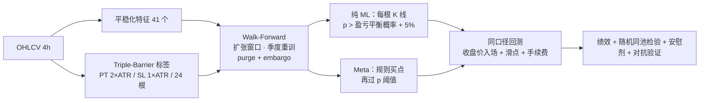
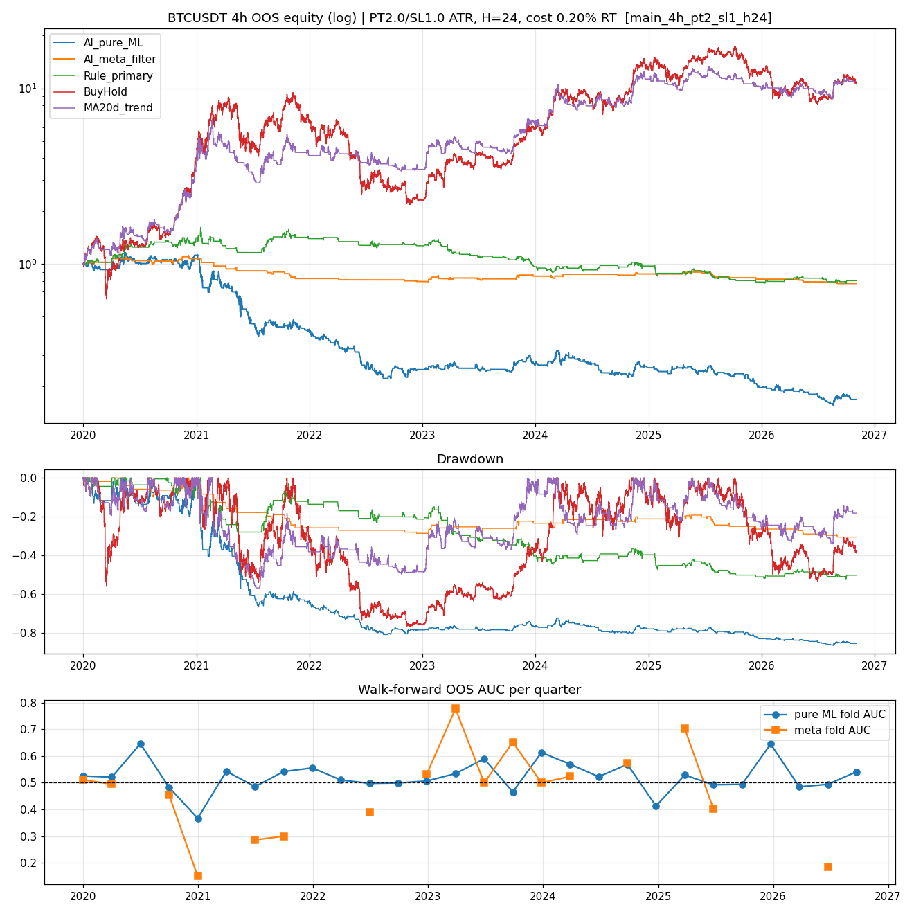
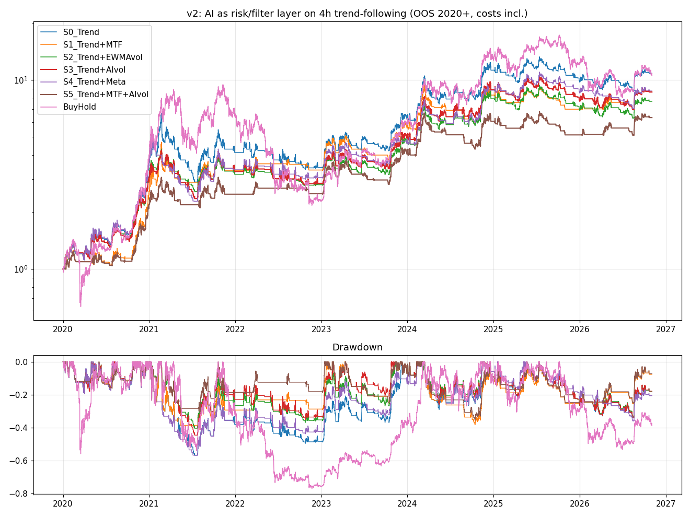

# BTC AI 交易模块 PoC：技术选型、实证验证与实盘价值评估

> **一句话结论**：用 OHLCV 特征 + LightGBM 去预测 BTC 方向，在严格的 Walk-Forward 和 0.20% 往返成本下**没有实盘价值**（样本外 AUC 0.527，与随机挑选无显著差异，p=0.67）。AI 在这个系统里能落地的位置是**风控层**（波动率预测、仓位缩放），不是 alpha 来源；而且到目前为止，真正改善回撤的手段是**规则**（多周期趋势过滤、EWMA 波动率目标），AI 只带来了统计上不显著的边际提升。

| 项目 | 内容 |
| --- | --- |
| 数据 | 仓库内 Binance 现货 `BTCUSDT` 1h / 4h / 1d，2017-08-17 → 2026-11-03（真实数据，非模拟） |
| 样本外 | 2020-01-01 → 2026-11-03（6.84 年，覆盖 2020-21 牛市、2022 熊市、2023-24 复苏、2025-26 震荡下行） |
| 成本 | 单边手续费 0.05% + 单边滑点 0.05% → **往返 0.20%** |
| 代码 | [run_experiment.py](run_experiment.py) · [iteration_v2.py](iteration_v2.py) · [verify_no_lookahead.py](verify_no_lookahead.py) |
| 登记 | `labs/experiments/registry.yaml` → `btc-ai-poc`（status: archived） |

---

## 第一步：技术路线对比与选型

| 维度 | 集成树（LightGBM / XGBoost / CatBoost） | 深度时序（LSTM / TFT / PatchTST） | 强化学习（PPO / DQN） |
| --- | --- | --- | --- |
| 样本需求 | 低：几千到几万条即可（BTC 4h 约 2 万根） | 高：单一资产的数据量撑不起参数量，容易记住噪音 | 极高：奖励稀疏、方差大，而且只有一条历史路径 |
| 对低信噪比的鲁棒性 | 强：可通过 `min_child_samples` / L2 正则 / 浅树压住复杂度 | 弱：日内收益的信噪比接近 0，网络容量多半用来拟合噪音 | 最弱：在单一历史路径上训练的策略，几乎必然过拟合回测模拟器 |
| 非平稳适应 | 重训一次只要几秒，季度甚至周度滚动重训都很便宜 | 重训成本高，滚动验证的工程量大 | 环境分布一变策略就失效，而且很难诊断原因 |
| 可解释 / 可审计 | 特征重要性、SHAP、概率分箱校准 | 黑箱为主（TFT 的注意力权重只能部分解释） | 黑箱，动作和风控耦合在一起 |
| 能否接入现有规则系统 | 很容易：直接输出概率，适合做过滤器或仓位乘数 | 中等 | 难：要把整个执行层交给它 |
| 主要风险 | 特征工程决定上限；树模型不擅长外推 | 过拟合、算力开销、验证周期长 | 模拟器偏差、奖励设计不当、风控失控 |

**选型：LightGBM。** 理由如下：
1. **数据量匹配**：单资产 4h 数据约 2 万样本、meta-labeling 只有几百样本，只有正则化的树模型能在这个量级上不严重过拟合。
2. **验证纪律成本低**：28 个季度折的 Walk-Forward 主配置约 16 秒跑完，所以安慰剂对照、成本敏感性、多周期稳健性都能做，这比模型本身更重要。
3. **与现有规则系统天然兼容**：仓库已有 MA / 缠论规则信号，LightGBM 输出概率，可直接作为 Meta-Labeling 过滤器或仓位乘数。
4. **路线逻辑**：如果最便宜、最稳健的模型在样本外都提取不到信号，换成 Transformer / RL 只会更容易“找到”虚假信号。先用 LightGBM 证伪或证实信号的存在，再决定是否升级模型。

---

## 第二步：验证方案



### 2.1 特征工程（41 个，全部平稳化，不输入原始价格）

| 类别 | 特征 |
| --- | --- |
| 动量 | `ret_{1,3,6,12,24,48,120}` 对数收益 |
| 波动率 | `vol_{12,48,120}`、`vol_ratio`（短 / 长波动比）、`atr_pct` |
| 均线偏离 / 斜率（按 ATR 标准化） | `ma_dev_{20,50,120,300}`、`ma_slope_{20,50,120,300}` |
| 位置 | `rsi_14`、`bb_pos`、`range_pos_{24,120}`、`dd_300`（距 300 根高点的回撤） |
| K 线形态 | `body_atr`、`upper_wick_atr`、`lower_wick_atr` |
| 成交量 / 订单流 | `vol_z_{24,120}`（对数成交量 z 分数）、`taker_ratio`、`taker_ratio_6`（主动买占比偏离）、`trades_z_120` |
| 日历 | `hour`、`dow` |

### 2.2 标签：Triple-Barrier

- 在每根 K 线**收盘价做多**：止盈 = +2×ATR14，止损 = −1×ATR14，时间屏障 = 24 根（4 天）。
- label = 1 表示止盈先于止损触发。保守撮合规则：开盘跳空越过止损 → 按开盘价止损；同一根 K 线内止损和止盈都触及 → **按止损算**。
- 标签与回测共用同一个函数（`triple_barrier`），训练目标与实际 PnL 口径完全一致。
- 入场规则：p > 盈亏平衡概率 + 5%。盈亏平衡概率 = (SL·ATR + 往返成本) / ((PT+SL)·ATR)，中位数为 0.378。阈值在看测试集之前就已固定，没有在测试集上调参。

### 2.3 防作弊机制（写在代码里，并有自检脚本验证）

| 机制 | 实现 |
| --- | --- |
| Walk-Forward | 扩张窗口，2020-01-01 起每 91 天重训一次，共 28 折；另有 3 年滚动窗口作为稳健性对照 |
| Purge + Embargo | 训练样本必须满足：标签结束位置 < 测试段起点 − 24 根 |
| 不调测试集 | LightGBM 超参数、阈值规则、meta 小样本缩放规则都是事前固定的 |
| 截断不变性 | 用前 k 根数据算出的特征 / 信号与全量数据的前 k 根**逐位相同**（差值 0.00e+00）✅ |
| 阳性对照 | 故意把未来 6 根收益塞进特征后，折均 AUC 升到 **0.877**，说明管线能检测出泄漏 ✅ |
| 安慰剂对照 | 训练标签随机打乱后重跑，用来衡量纯运气能带来的表现 |
| 随机同池检验 | 从同一候选池随机抽同样笔数做 5000 次蒙特卡洛，检验模型选出的交易是否显著优于随机 |

> [!NOTE]
> 第一次运行时，meta 模型因为 `min_child_samples=200` 大于训练样本数（115~480）而**一棵树都没分裂**，输出常数、成交 0 笔。这是配置 bug，不是研究结论。修复方式是加入事前固定的小样本缩放规则（`min_child_samples = n/15`、浅树），然后重跑全部配置。文中报告的都是修复后的结果。

---

## 第三步：样本外绩效（4h 主配置，2020-01 → 2026-11）



### 3.1 交易层面

| 策略 | 笔数 | 笔 / 月 | 胜率 | 平均盈 | 平均亏 | 盈亏比 | 期望（%/笔） | 期望（R/笔） | 持仓占比 |
| --- | ---: | ---: | ---: | ---: | ---: | ---: | ---: | ---: | ---: |
| **AI 纯 ML** | 641 | 7.8 | 34.3% | +3.08% | −1.98% | 1.56 | **−0.24%** | **−0.123R** | 25% |
| **AI Meta 过滤** | 75 | 0.9 | 32.0% | +2.50% | −1.65% | 1.51 | **−0.32%** | **−0.199R** | 3% |
| 规则买点（MA20 上穿 + MA120 向上） | 269 | 3.3 | 36.4% | +2.92% | −1.76% | 1.66 | −0.05% | −0.078R | 12% |

### 3.2 资金曲线层面与基准对比

| 策略 | 年化 | 最大回撤 | Sharpe | Calmar |
| --- | ---: | ---: | ---: | ---: |
| **AI 纯 ML** | **−22.9%** | −86.5% | −0.81 | −0.26 |
| **AI Meta 过滤** | **−3.7%** | −30.5% | −0.49 | −0.12 |
| 规则买点 | −3.2% | −51.2% | −0.12 | −0.06 |
| BTC 买入持有 | 41.4% | −76.6% | 0.88 | 0.54 |
| 简单均线（4h 收盘 > 20 日均线） | 41.9% | −56.4% | 1.06 | 0.74 |

### 3.3 预测力诊断

| 指标 | 值 | 解读 |
| --- | --- | --- |
| 样本外 AUC（纯 ML / Meta） | 0.527 / 0.461 | 纯 ML 只比抛硬币略好；Meta 比随机还差 |
| 28 折 AUC 均值 / >0.5 占比 | 0.523 / 61% | 每季 AUC 在 0.37~0.65 之间跳动，不稳定 |
| 随机同池检验 p 值（纯 ML / Meta） | **0.67 / 0.81** | 模型选出的交易**不比随机挑的好** |
| 概率校准 | 预测 0.54 → 实际命中 0.34 | 严重过度自信，概率本身不可信 |
| 对抗验证 AUC（训练期 vs 测试期特征） | **0.982** | 两段时期的特征分布几乎可以完美区分，漂移非常严重 |
| Meta：被选中 vs 被拒绝的平均净收益 | −0.25% vs −0.06% | 过滤器**反向**了：留下的反而更差 |

### 3.4 稳健性矩阵（v1，8 组配置）

| 配置 | 纯 ML 年化 | 纯 ML E[R] | 随机检验 p | Meta 年化 | 规则年化 | 1R 成本 |
| --- | ---: | ---: | ---: | ---: | ---: | ---: |
| 主配置 4h PT2/SL1/H24 | −22.9% | −0.123 | 0.67 | −3.7% | −3.2% | 0.13R |
| 安慰剂（打乱标签） | −5.4% | −0.089 | 0.30 | **+1.1%** | — | 0.13R |
| 零成本 | +3.1% | **+0.075** | 0.28 | −2.3% | +4.7% | 0 |
| 3 年滚动窗口 | −18.1% | −0.099 | 0.30 | −4.6% | −3.2% | 0.13R |
| 4h PT3/SL1.5/H48 | +3.0% | +0.066 | 0.11 | −6.8% | +0.4% | 0.09R |
| 4h PT6/SL2/H120（趋势） | +3.6% | +0.081 | 0.51 | −6.4% | +10.4% | 0.07R |
| **1h** PT2/SL1/H24 | −2.9% | −0.049 | **0.0006** | −1.3% | −29.1% | **0.28R** |
| 1d PT2/SL1/H10 | +5.5% | +0.081 | 0.34 | 样本不足 | +3.2% | 0.05R |

**所有配置的年化收益都远低于买入持有（41%）和简单均线（42%）**。安慰剂版的 Meta 甚至比真模型更好，说明 Meta 的表现是噪音。唯一统计显著的是 1h 的排序能力：p=0.0006，16 次检验经 Bonferroni 校正后的阈值为 0.003，仍然显著。但这个优势只有每笔 +0.2%，而 1h 上每笔的 1R 成本高达 0.28R，期望最终仍为负。

---

## 第四步：实用价值批判与优化迭代

### 4.1 是否有实盘价值？——没有

- **超额收益为负且不显著**：主配置下纯 ML 年化 −22.9%，相比买入持有的超额收益约为 −64 个百分点；随机同池检验 p=0.67，说明模型选择没有优于随机。
- **零成本时期望只有 +0.075R/笔**，而 4h 上每笔真实成本约 0.13R。**哪怕收益完全来自信号，也不够付手续费和滑点。**
- **连规则基线的优势都不显著**：均线策略相对买入持有 Sharpe +0.17，块自助法 95% 置信区间为 [−0.39, +0.71]，p=0.31。它的真实价值是**把最大回撤从 77% 降到 56%**，而不是提高收益。

### 4.2 问题出在哪里？——归因

**① 信噪比过低 + Regime Shift（主因）**
- 对抗验证 AUC 0.982：2020 年前后的特征分布几乎没有重叠，模型在 2017-2019 学到的规律，到 2020 年后已经不在同一个分布里。
- 标签基率逐年漂移：止盈先到的比例在 2018 年为 26.9%、2020 年为 38.1%、2022 年为 26.3%、2024 年为 34.7%。模型主要是在学“当年是牛市还是熊市”，而这一点事先无法知道。
- 特征重要性前几位是 `vol_48 / vol_120 / ma_slope_300 / ma_dev_300`，都是**慢变量、状态类特征**。也就是说，模型学到的是牛熊状态（一阶趋势），而这一点一根均线就能做到，而且做得更便宜。
- 概率严重过度自信：预测 0.54 的样本实际命中只有 0.34。

**② 胜率与盈亏比错配**
- 2:1 屏障下的理论盈亏平衡胜率是 33.3%，加上成本后是 37.8%；模型实际胜率 34.3%，落在两者之间，被成本吃掉。
- 止损触发占 65%、止盈只占 33%：同一根 K 线内止损和止盈都触及时一律按止损算，叠加跳空，实际盈亏比从理论的 2.0 降到 **1.56**。
- 趋势策略恰好相反：胜率只有 **18%**，但盈亏比 **8.9**，**前 5 笔交易贡献了 80% 的利润**。这种分布不适合拿分类器做过滤：只要错杀一笔大趋势，全年收益就没了。v2 的 Meta 过滤就错杀了前 10 大盈利交易中的 1 笔，被它拒掉的 65 笔合计还是**盈利**的（+30.5%）。

**③ 顺势 / 逆势环境错位**
- 年度分解：纯 ML 在 2021 年 −63.7%、2022 年 −38.6%。2021 年 5 月之后的高波动震荡期和 2022 年熊市持续止损，而做多的固定 ATR 屏障在单边下跌中没有任何保护作用。
- 短线固定屏障与 BTC 的收益分布不匹配：BTC 的利润集中在少数大趋势里，2×ATR 止盈恰好把肥尾截掉了。PT6/SL2/H120 的趋势屏障下规则年化 +10.4%，也印证了这一点。
- 1h 上频率越高越糟：规则买点每月 14 笔、年化 −29.1%，每笔 0.28R 的成本把一切都抹平了。

### 4.3 迭代 v2：把 AI 从“预测方向”挪到“风控 / 过滤”（已实测）

基础策略换成本身期望为正的 4h 趋势跟随（收盘 > MA120），在其上叠加三种增强。成本口径不变，按仓位变化量收费。



| 策略 | 年化 | 最大回撤 | Sharpe | Calmar | 持仓占比 | 调仓次数 |
| --- | ---: | ---: | ---: | ---: | ---: | ---: |
| S0 趋势（收盘 > MA120） | 41.9% | −56.4% | 1.06 | 0.74 | 54% | 558 |
| S1 + 多周期（日线 MA50 向上） | 37.1% | **−40.2%** | 1.07 | **0.92** | 37% | 336 |
| S2 + EWMA 波动率目标（50%） | 34.9% | −40.1% | 1.05 | 0.87 | 47% | 717 |
| S3 + **AI 波动率预测**目标 | 37.2% | −44.4% | 1.07 | 0.84 | 49% | 931 |
| S4 + **AI Meta 过滤**趋势段 | 37.4% | −56.3% | 1.05 | 0.67 | 44% | 428 |
| S5 多周期 + AI 波动率 | 31.0% | **−35.4%** | 1.06 | 0.87 | 34% | 626 |
| 买入持有 | 41.4% | −76.6% | 0.88 | 0.54 | 100% | 1 |

**AI 子模块的独立检验**

| 检验 | 结果 | 结论 |
| --- | --- | --- |
| 波动率预测 QLIKE（越低越好） | LightGBM 0.331 / EWMA 0.358 / 滞后 30 根 0.459 | AI 比 EWMA **好 7.6%**，预测层面确有提升 |
| 波动率预测相关性（log） | LightGBM 0.648 / EWMA 0.659 | 排序能力相当 |
| S3 AI 波动率 vs S2 EWMA：Sharpe 差 | +0.03，95% CI [−0.08, +0.14]，p=0.33 | 策略层面**不显著** |
| S4 Meta vs S0：Sharpe 差 | −0.005，p=0.49 | **无效**，还错杀了一笔大趋势 |
| S1 多周期 vs S0：Sharpe 差 | +0.01，p=0.41 | Sharpe 不变，但最大回撤 −56% → −40%，**纯规则** |

**v2 的结论**：波动率是可预测的，AI 也确实比 EWMA 预测得略好，但这点优势传导到策略后被调仓成本和迟滞带稀释，最终不显著。**在当前数据和特征下，降低回撤最有效的手段是规则**（多周期过滤 + 波动率目标），这两项都不需要 AI。

### 4.4 下一步怎么做（按优先级）

| 优先级 | 方向 | 具体做法 | 判据 |
| --- | --- | --- | --- |
| **P0 现在就做** | 先落地规则风控，不上 AI | 把 S1（多周期）或 S2（EWMA 波动率目标）接入现有告警 / 执行系统：只做多、不加杠杆，仓位迟滞带 10% | 纸面交易 3 个月，回撤与成交滑点符合回测口径 |
| **P1 换数据而非换模型** | 只用 OHLCV 已经到天花板 | 加入永续合约资金费率、持仓量变化、期现基差、爆仓量、主动买卖不平衡（仓库已有 Binance USD-M 数据源）以及 ETH/BTC、NDX、DXY 跨资产特征 | 4h 样本外 AUC > 0.55，且随机同池检验 p < 0.01 |
| **P1 扩样本** | Meta-labeling 只有约 300 个标签，统计功效太低 | 用 BTC + ETH + 前 20 大币种（特征全部是标准化比值，可直接混合训练）把标签数扩大 10~20 倍；按币种分组做 Walk-Forward | Meta 在**期望为正**的基础策略上，被拒交易的平均收益显著 < 被保留交易 |
| **P2 先降成本** | 1h 是唯一有显著排序能力的周期，但被成本吃掉 | 改用 maker 挂单（手续费约 0.02%、滑点约 0），用实盘成交记录估计真实成本后复测 `--timeframe 1h --fee 0.0002 --slip 0` | 往返成本 < 0.1R 时 E[R] 转正，并经多重检验校正后仍显著 |
| **P2 改标签** | 固定 2×ATR 截断了 BTC 的肥尾 | 改用动态屏障（追踪止损 / 趋势结束出场），或把预测目标改成**尾部风险**（未来 5 天回撤 > 2×ATR 的概率）专门用于降仓 | AI 降仓相对 EWMA 的 Sharpe 差 95% CI 下界 > 0 |
| **P3 上线门禁** | 防止多次尝试后挑出侥幸结果 | 记录每次实验尝试的配置数，用 Deflated Sharpe Ratio 和 CSCV 计算过拟合概率（PBO）；PBO < 0.2 才允许上纸面交易 | 门禁写进 `experiment_core` 的发布流程 |
| 暂不考虑 | 深度学习 / 强化学习 | 在 LightGBM 都提取不到方向信号的前提下，换更复杂的模型只会更容易过拟合 | P1 的新数据确认存在信号之后再评估 |

> [!WARNING]
> **局限**：本次只测了单一资产（BTC）、只做多、现货（没有资金费率成本）；滑点按 0.05% 固定估计，未建模冲击成本；共尝试 8 组配置 × 2 种模型，数字未做 Deflated Sharpe 校正，所以正收益配置也应当打折看待。

### 复现

```bash
python3 experiments/btc_ai_poc/run_experiment.py --suite     # v1，8 组配置，约 3 分钟
python3 experiments/btc_ai_poc/iteration_v2.py               # v2，约 20 秒
python3 experiments/btc_ai_poc/verify_no_lookahead.py        # 防未来函数自检
python3 experiments/btc_ai_poc/run_experiment.py --csv your_4h.csv --tag mycsv   # 对接本地 CSV
python3 experiments/btc_ai_poc/run_experiment.py --source ccxt                   # 在线拉取（需 pip install ccxt）
```
