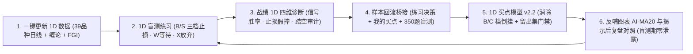

# Next Step：1D 一键数据更新、练习复盘闭环与买点模型迭代实施方案

> 更新日期：2026-11-18  
> 范围边界：**严格限定 `1D` 日线级别**（`4H` / `1H` / `15F` 等其他级别全部不做更新、不做练习、不做模型迭代）。

## 1. 目标总览

1. **工具栏一键更新最新 `1D` 数据**：在 Web 端顶部工具栏提供 `🔄 更新日线` 按钮，支持一键拉取全部 39 个品种（或仅当前品种极速更新）的最新日线行情、增量重算 `1D` 缠论结构、`MACD` 三段背离（`1D`）与加密恐慌贪婪指数（`FGI`），并在完成后**免刷新热重载**当前图表。
2. **`1D` 练习与复盘闭环 × `1D` 买点模型迭代同步推进**：打通「**更新最新 1D 行情 → 1D 盲测快速下单/等待/放弃 → 战绩多维复盘诊断 & 错题/漏单沉淀 → 1D 人类反馈样本回流 → 1D 买点模型 v2.2 校准与门禁验证 → 反哺实盘信号与盘后复盘**」的完整飞轮。

---

## 2. 待实施模块拆解

### 模块一：一键更新最新 `1D` 数据引擎与前端交互

核心原则：**只拉取、重算 `1D` 日线**（跳过耗时的 `4H`、`1H`、`15F` 拉取与切片构建），将全量更新时间从分钟级压缩至秒级，并保证单品种异常互不阻塞。

#### 1.1 `1D` 专属增量更新与原地构建管线
- **`[MODIFY]` [`scripts/ops/update_all_data.py`](scripts/ops/update_all_data.py)**
  - 新增 `--only-1d` 与 `--symbols BTC,AAPL,...` CLI 参数及可编程入口 `run_update_1d(symbols=None, progress_cb=None)`：
    - 加密货币（`BTC`, `ETH`, `SOL`, `PEPE`, `HYPE`）仅拉取 `1day`，跳过 `4h` 与 `1h`。
    - 美股（18 只）、A 股（7 只）、港股（2 只）、指数（`SPX`, `NDX`, `N225`, `399006_SZ`, `000688_SS`）、贵金属（`XAUUSD`, `XAGUSD`）按分市场增量更新 `*_1day.parquet`，支持单品种超时与失败隔离（任一数据源慢或限流绝不阻塞其余品种），每完成一个阶段通过 `progress_cb` 输出结构化进度（当前品种、新增根数、最新日期、耗时、告警）。
    - 完全跳过 `build_intraday_chunks.py`（`15F`）。
    - 顺带增量刷新 `apps/chanlun-web/data-view/fng_data.js`（拉取 `alternative.me` 最近日度 FGI，网络失败时静默保留原文件）。
- **`[MODIFY]` [`apps/chanlun-web/build_all_symbols.py`](apps/chanlun-web/build_all_symbols.py)**
  - 新增 `--only-1d` 与 `--symbols` 参数：
    - 对目标品种仅读取 `1day` parquet 运行 `chanlun.analyze` 生成最新 `levels["1D"]`。
    - 若目标 `data-view/data*.js` 已存在且含历史 `4H` / `1H` 字段，则**原地替换 `levels["1D"]` 与 `generated_at`** 而不重算 `4H` / `1H`（既严格不做其他级别更新，又保证现有渲染回归脚本 `apps/chanlun-web/tools/verify_render.py` 零破坏，速度提升约 5 倍）。
- **`[MODIFY]` [`scripts/strategies/run_macd_3seg_validation.py`](scripts/strategies/run_macd_3seg_validation.py)**
  - 新增 `--only-1d` 快速导出模式：仅重算 `WEB_PANELS` 中 39 个品种的 `1D` 三段背离序列并原地合并写回 `apps/chanlun-web/data-view/macd3seg_data.js`。

#### 1.2 零依赖本地服务 `serve.py` 与工具栏更新组件
- **`[NEW]` `apps/chanlun-web/serve.py`**
  - 基于 Python 标准库 `ThreadingHTTPServer`（参考 [`apps/chanlun-web/tools/serve_mobile.py`](apps/chanlun-web/tools/serve_mobile.py)），默认监听 `127.0.0.1:8081`（支持 `--port`）：
    - 静态托管 `apps/chanlun-web/`，对 `data-view/*.js` 设置 `Cache-Control: no-store` 确保更新后立即可读最新 K 线。
    - `GET /api/data-status`：返回服务端在线标记、39 品种 `1D` 最新日期汇总（按加密/美股/A股/港股/贵金属分组）及当前后台任务状态。
    - `POST /api/update-1d`：接收 `{ "scope": "all" | "current", "symbol": "BTC" }`，后台单实例线程执行 `--only-1d` 更新管线（防并发重入锁）。
    - `GET /api/update-1d/status`：返回实时进度百分比、当前步骤、各市场成功/失败明细与新增 K 线统计。
    - `POST /api/feedback-1d/sync`：将前端 `1D` 练习决策与手工买点落盘至 `data/feedback/user_1d_feedback.json`（供模块三模型迭代一键读取）。
- **`[NEW]` `apps/chanlun-web/js/20-data-updater.js`** & **`[MODIFY]` [`apps/chanlun-web/index.html`](apps/chanlun-web/index.html)** & **`[MODIFY]` [`apps/chanlun-web/css/main.css`](apps/chanlun-web/css/main.css)**
  - 在顶部工具栏品种选择器 `#symSelect` 右侧新增紧凑按钮 `#dataUpdateBtn`（显示 `🔄 更新日线` 及当前品种最新日线日期徽标）；主界面周期展示统一收敛聚焦 `1D`。
  - 点击展开轻量进度浮层：支持 **「仅更新当前品种（约 1~2s）」** 与 **「全量更新 39 品种 1D」**，实时滚动展示分市场拉取与重算进度（若通过 `file://` 或普通 `http.server` 打开，自动弹出 `python3 apps/chanlun-web/serve.py` 一键复制启动提示）。
  - 更新完成后，自动清理 `SYM_DATA_CACHE[sym]` 并调用 `switchSymbol(currentSym, true)` **无感热刷新当前 K 线图与指标**（若正处于盲测未揭示状态，则提示“后台已更新，揭示或结束本局后生效”，绝不打断或剧透正在进行的练习）。

---

### 模块二：`1D` 练习与复盘闭环（仅 `1D`）

针对目前「快速下单选了入场标签与三档止损，但平仓落库后标签/止损方式丢失、`战绩` 只有笼统总胜率、`W/X` 等待放弃无事后验证」的断点，补齐 `1D` 全链路数据闭环。

#### 2.1 全面收敛至 `1D` 并补全交易/决策归因字段
- **`[MODIFY]` [`apps/chanlun-web/js/06-trainer.js`](apps/chanlun-web/js/06-trainer.js)**
  - 练习配置面板 `#trTfSel` 与随机抽样池锁定为 **`1D`**（覆盖全部 39 个 `1D` 品种，补齐此前随机池遗漏的 `HYPE`），确保所有新产生的盲测局均为标准 `1D` 样本。
- **`[MODIFY]` [`apps/chanlun-web/js/05-journal.js`](apps/chanlun-web/js/05-journal.js)** & **`[MODIFY]` [`apps/chanlun-web/js/06-quick-order.js`](apps/chanlun-web/js/06-quick-order.js)**
  - 开仓与平仓结算写入 `closed` 交易记录时，完整保留结构化元数据：
    - `tags`: `{ market, entry, pattern }`（如 `["突破MA20"]`、`["蓄势"]`）
    - `quick`: `{ via, stopMethod, stopPicked, tagSource, decisionMs }`（区分 `L 本根最低/最高`、`P 波段极值`、`A 1.5×ATR`、`图上点选`，以及标签是自动推荐采纳还是手动点选）
    - `modelSnap`: 开仓当根**纯因果**计算的 `1D` 模型快照 `{ tradScore, grade, tier, reasons, execStop }`（练习中后台静默记录，**仅在揭示答案后及战绩复盘中可见**）。
    - `postExit`: 揭示/结算时自动补算离场或止损后 20 根内的后续走势（用于识别**“止损被扫后 20 根内反向走出 ≥2R 的假摔惜败单”**）。
- **`[MODIFY]` [`apps/chanlun-web/js/06-practice-core.js`](apps/chanlun-web/js/06-practice-core.js)** & **`[MODIFY]` [`apps/chanlun-web/js/06-practice.js`](apps/chanlun-web/js/06-practice.js)**
  - 对练习中的 **`W`（等待）** 与 **`X`（放弃）** 决策，在揭示/归档时以当根收盘价 + 默认因果止损（`min(low[i-2..i])` 及本根极值双口径）调用 `PracticeCore.outcomes` 计算后续 5/20/60 根的反事实结果（是否 ≤5 根止损=**成功避坑**，还是未破止损走出 ≥3R=**踏空漏单**）。

#### 2.2 右侧「战绩」Tab 新增 `1D` 四维复盘诊断看板
- **`[MODIFY]` [`apps/chanlun-web/js/06-trainer.js`](apps/chanlun-web/js/06-trainer.js)** & **`[MODIFY]` [`apps/chanlun-web/index.html`](apps/chanlun-web/index.html)**
  - 在右侧边栏 `战绩` 面板新增紧凑可切换的 **「1D 复盘诊断」** 卡片（自动过滤统计 `tf === '1D'` 会话）：
    1. **信号标签期望值榜**：按入场标签（`突破MA20`、`回踩MA20`、`双均线突破`、`MACD背离`、`Pinbar` 等）及市场环境分组，展示笔数、胜率、≤5 根快损率、平均实现 `R`、最大浮盈 `MFE R`。
    2. **三档止损方式体检**：对比 `本根 L` vs `波段 P` vs `ATR A` 的平均初始风险宽、触发止损率、均 `R` 与**被扫损假摔率**（止损后未破波段低又涨超 2R 的比例）。
    3. **等待/放弃反事实审计（避坑 vs 踏空）**：汇总 `W / X` 决策的避坑率与踏空率；列出高价值踏空单与高频错题局，每行提供 **「🎯 同区间重练」** 与 **「＋ 收入我的1D买点」** 一键按钮，直接把复盘发现的好机会转成模型正样本。
    4. **人机对照矩阵（你的操作 vs `1D` 模型分档）**：展示在模型 `A / B / C / D` 四档位置上的开单率、实盘均 `R` 与放弃率；并在每局练习点击 `揭示答案` 后，在主图复盘摘要条展示本局各决策点的模型分档对照。

#### 2.3 `1D` 多品种画线按品种独立存储
- **`[MODIFY]` [`apps/chanlun-web/js/08-draw.js`](apps/chanlun-web/js/08-draw.js)** & **`[MODIFY]` [`apps/chanlun-web/js/00-app-core.js`](apps/chanlun-web/js/00-app-core.js)**
  - 将手绘线条按 `1D` 品种隔离存储（`BTC` 默认继续兼容 `chan_drawings_v2` 键，其余品种使用 `chan_drawings_v2_<SYM>`，切换品种时自动保存旧品种画线并恢复新品种画线），避免跨品种复盘/练习时趋势线与水平线串台。

---

### 模块三：`1D` 买点模型迭代（`MA20-TRAD-v2.2` · 仅 `1D`）

#### 3.1 现状根因诊断（基于 40 品种 `1D` 统计报告）
在 [`reports/transfer/trad_ma20_40assets_20261109.json`](reports/transfer/trad_ma20_40assets_20261109.json) 与 [`apps/chanlun-web/js/13-annotate.js`](apps/chanlun-web/js/13-annotate.js) 中，当前 `v2.1` 查表打分存在三个明确可量化的瓶颈：
- **`B档 (55~74)` 与 `C档 (35~54)` 跨品种收益倒挂**：8,118 笔全品种 `1D` 信号中，`B档` 的 60 根 3R 达成率仅 `29.5%`（均 `+0.469R`，5 根快损 `39.8%`），反不如 `C档` 的 `32.5%`（均 `+0.498R`，5 根快损 `38.2%`）。
- **倒挂结构性原因**：
  1. 基础分 `50` 只需叠加单项 `顺势支撑 (+10)` 即得 `60分` 进入 `B档`，放进了大量**箱体未收敛（`5.5 < box25Atr <= 7.5`）、头顶紧贴 20 日前高阻力（`1.2 < distHi20Atr <= 2.5`）且无量能配合**的平庸追高突破单。
  2. `annTradScoreAt` 完全未使用**成交量比（`vol_ratio = v[i] / av20[i]`）**与**MACD 柱斜率修复**特征。
  3. 训练评估脚本候选触发器仅取 `c[i-1] <= m20[i-1] && c[i] > m20[i]`（单根上穿），未统一纳入 **`回踩MA20再站上（reclaim 1~3根）`** 与 **同波段 8 根冷却去重** 口径。

#### 3.2 样本桥接与 `1D` 模型 v2.2 校准管线
- **`[NEW]` `scripts/analysis/iterate_1d_model.py`**
  - **多源 `1D` 人类标注与结果融合**：
    1. `annotations-BTC-1D-manual.json`（72 笔 BTC `1D` 手工确认买点）
    2. `reports/blind/enriched_350.parquet`（350 题跨品种 `1D` 盲测标注 + 20 题陷阱题，人类一致性 $\kappa = 0.861$）
    3. `data/feedback/user_1d_feedback.json`（由前端练习 `PracticeStore` 中的 `1D` `buy/wait/skip` 决策 + `manual_buy_v1`「我的买点」一键同步生成）
    4. 39 品种最新 `1D` parquet 全量冷却去重候选池（统一 `annCalcOrderOutcome` 策略 A/B 轨迹模拟）。
  - **特征增强与打分表 v2.2 校准（保持 100% 白盒可解释）**：
    - 保持 ATR 归一化无量纲体系（跨加密、美股、A股、港股、贵金属通用），新增并检验：
      - **量能确认项**：突破/回踩阳线 `vol_ratio` 分位数加成与极度缩量虚破扣分；
      - **头顶阻力精细惩罚**：拆分 `distHi20Atr`“紧贴前高未破（`0.3~1.5 ATR` 假突破高发区）”与“已有效突破前高箱体（`<= 0.2 ATR`）”；
      - **企稳底部反弹豁免**：当箱体高度极度收敛 + 量能放大 + `MA20` 拐头走平（`s20 >= 0`）时，缓解单纯 `!above60` 造成的一刀切 `-20` 误杀。
  - **严格防过拟合留出集门禁（Gate Check）**：
    - 按**时间切分（Pre-2024 训练校准 / 2024+ 样本外留出）** + **90 题盲测独立留出集** + **20 题已知陷阱题**三重门禁验证。
    - **硬性准入条件**：仅当 `v2.2` 同时满足：(1) 样本外 39 品种 `A > B > C > D` 四档在 `hit3r_60`、`策略B 均R` 上**严格单调递减**且 `stop_le5` 单调递增（彻底消除 B/C 倒挂）；(2) 90 题盲测留出集人类偏好 AUC 不低于 `v2.1`；(3) 20 题陷阱题否决率 $\ge 90\%$ 时，才导出新参数至 `reports/model-1d-v2.2/` 与前端配置。
- **`[MODIFY]` [`apps/chanlun-web/js/13-annotate.js`](apps/chanlun-web/js/13-annotate.js)** & **`[MODIFY]` [`apps/chanlun-web/js/17-ai-ma20-algo.js`](apps/chanlun-web/js/17-ai-ma20-algo.js)**
  - 将通过门禁的 `MA20-TRAD-v2.2` 参数表同步至 `annTradScoreAt`（与 Python 侧保持逐笔 `1e-9` 精度对齐测试），并在「战绩 / 标注」面板提供 **「📤 同步 1D 练习样本并重评模型」** 按钮（连接 `serve.py` 时一键触发重评并展示新旧档位对比摘要；纯静态模式下支持一键导出统一反馈 JSON）。

---

## 3. 验证与门禁计划

1. **一键更新 `1D` 数据服务与前端热重载测试**：
   - 验证 `update_all_data.py --only-1d --dry-run` 与 `build_all_symbols.py --only-1d --symbols BTC,PEPE` 仅读写 `1D` 数据、耗时 < 3 秒，且 `python3 apps/chanlun-web/tools/verify_render.py` 100% 通过。
   - 启动 `python3 apps/chanlun-web/serve.py` 并运行新增无头浏览器端到端脚本 `apps/chanlun-web/tools/verify_data_updater_browser.mjs`：验证 `GET /api/data-status`、点击 `#dataUpdateBtn` 触发单品种更新、进度条更新及图表无刷新热重载且零控制台报错。
2. **`1D` 练习与复盘诊断闭环验证**：
   - 运行 `node --test apps/chanlun-web/tests/*.test.mjs`（新增 `practice_1d_diagnostics.test.mjs` 测试信号标签聚合、三档止损假摔率计算、`W/X` 反事实 5/20/60 根结果归类）。
   - 无头 Chrome E2E 验证：开启练习确认周期锁定 `1D` → 执行 `B` 开多（选定止损档位与入场标签）、`W` 等待、`X` 放弃 → 走步平仓并点击 `揭示答案` → 校验揭示后模型分档对照显示（且揭示前 DOM 中零泄露）→ 打开 `战绩` Tab 校验四维诊断面板渲染、「收入我的买点」与跨品种画线隔离正常。
3. **`1D` 买点模型 v2.2 门禁与前后端一致性验证**：
   - 运行 `python3 scripts/analysis/iterate_1d_model.py --verify`：检查训练/时间留出集（2024+）/ 90 题盲测留出集 / 20 题陷阱题指标，确认 `A / B / C / D` 四档跨 39 品种 `1D` 严格单调（消除 B/C 倒挂）。
   - 运行跨语言一致性校验脚本，抽样核对 Python `iterate_1d_model.py` 与 JS `annTradScoreAt` 在加密、美股、A 股、贵金属 `1D` 样本上的打分、止损位与 `annCalcOrderOutcome` 100% 一致，并回归全部既有浏览器测试套件确保零破坏。
